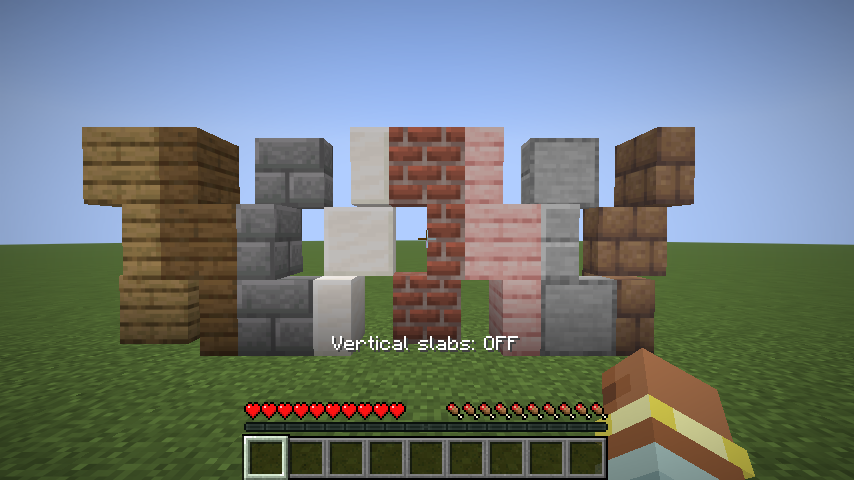
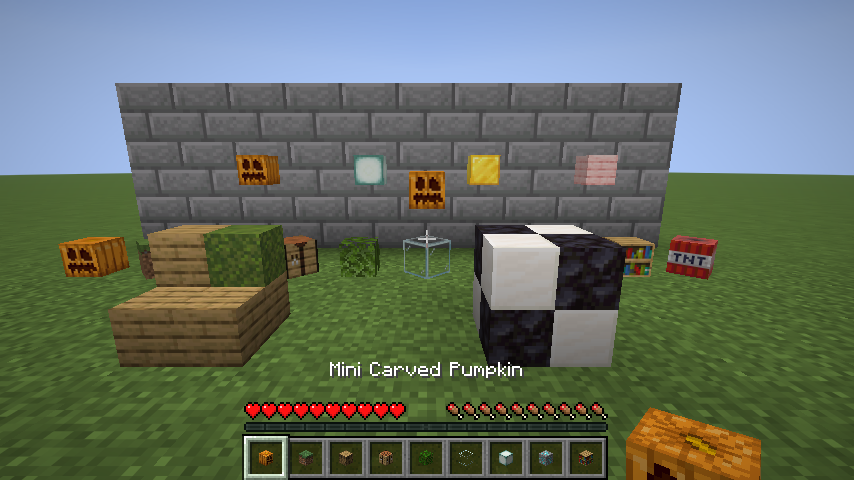
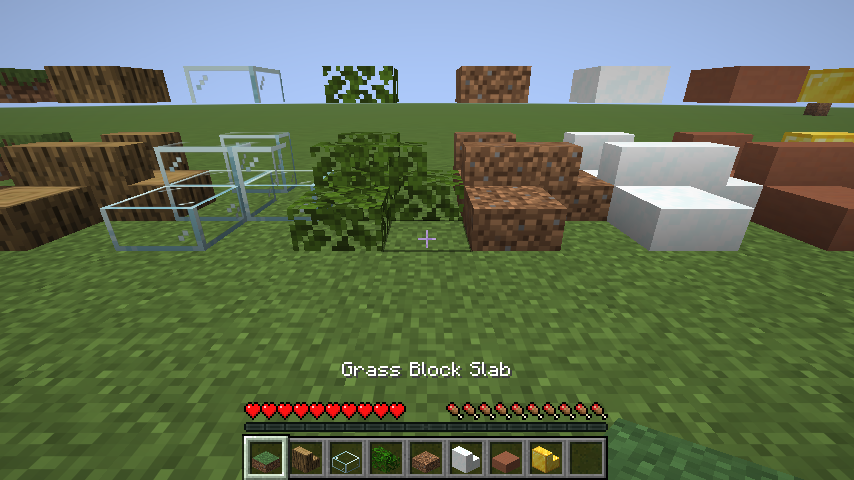
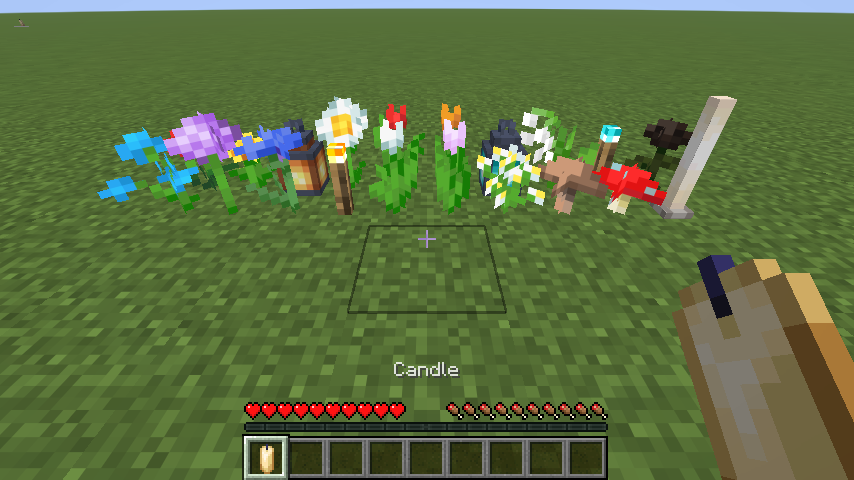
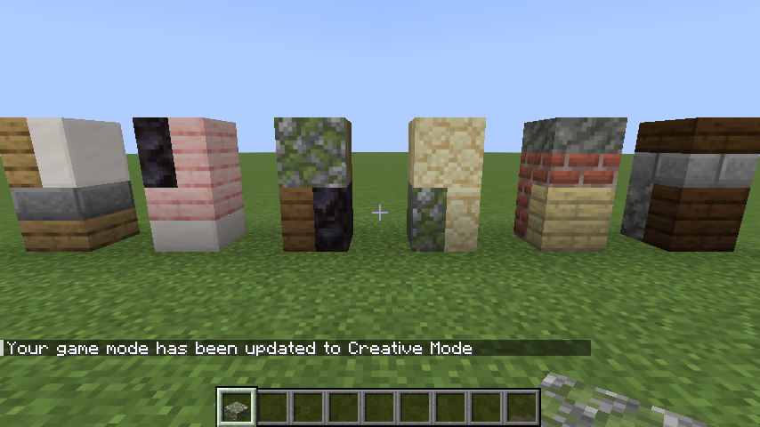

# Baukunst

Eine persönliche Minecraft-Mod (Fabric, Minecraft **26.3**) mit kleinen Helfern zum **schön Bauen**.



## Features

### Vertikale Stufen (Slabs)
Alle Stufen aus Vanilla-Minecraft (101 Stück – Holz, Stein, Ziegel, Kupfer, …) lassen sich auch
**seitlich** platzieren – also in die linke/rechte bzw. vordere/hintere Hälfte eines Blocks statt nur oben oder unten.

- **`V`** drücken schaltet den Modus „Vertikale Stufen“ an/aus (Taste in *Optionen → Steuerung → Baukunst* änderbar).
- **Seite eines Blocks anklicken:** Die Stufe legt sich an diesen Block an.
- **Ober-/Unterseite anklicken:** Die Stufe landet in der Hälfte, auf die du zielst (nahe am Rand zielen).
- Zwei gleiche vertikale Stufen ergeben zusammen einen ganzen Block – wie bei normalen Stufen.
- Hitbox, Kollision, Wasser­logging und Drops funktionieren wie bei normalen Stufen.

### Mini-Blöcke


Jeder volle 1:1-Block aus Vanilla (404 Stück – Stein, Holz, Erze, Glas, Wolle, Beton, Laub, Kürbis, …)
gibt es zusätzlich als **Mini-Block** in Spielerkopf-Größe.

- **Bekommen:** In der **Steinsäge** wird aus 1 Block → 4 Mini-Blöcke. Im Kreativmodus gibt es alle im Tab **„Mini-Blöcke“**.
- **Platzieren wie ein Spielerkopf:** Auf dem Boden in 16 Drehrichtungen (die Vorderseite schaut zu dir) oder seitlich an eine Wand geklickt hängend.
- Die Mini-Blöcke nutzen automatisch das Original-Modell und die Texturen des Blocks (inkl. Gras-/Laubfarbe je nach Biom, Glas durchsichtig, Leuchtblöcke leuchten).
- Abbauen geht mit der Hand, sie droppen sich selbst.
- **Raster-Modus (Shift):** Mit gedrückter Shift-Taste rasten Mini-Blöcke im **2×2×2-Raster** ein – bis zu 8 Stück pro Block,
  auch aus verschiedenen Materialien. So lassen sich kleine Treppen, Muster, Möbel oder Statuen „voxeln“.
  Abbauen entfernt nur den Mini-Block, auf den du schaust.

### Stufen & Treppen für jeden Baublock


Für alle Baublöcke, die in Vanilla keine Stufe/Treppe haben, gibt es jetzt beides (539 neue Blöcke) – z. B. Erde, Gras,
Stämme, Laub, Glas, Terrakotta, Erze, Eis, Kupfer …

- Im Kreativ-Inventar stehen sie **direkt hinter ihrem Block** in den normalen Tabs.
- **Steinsäge:** 1 Block → 2 Stufen bzw. 1 Treppe.
- Die neuen Stufen lassen sich mit `V` ebenfalls **vertikal** platzieren.
- Abbau-Werkzeug wie beim Original (z. B. Spitzhacke für Stein-Treppen, Schaufel für Erd-Stufen), doppelte Stufen droppen 2.
- Ausgenommen sind Funktionsblöcke wie Werkbank, TNT, Kolben oder Bücherregal.

### Kleinkram: bis zu 4 kleine Blöcke in einem Feld


Kleine Vanilla-Blöcke – Blumen, Pilze, Laternen, Fackeln, Ketten, Kerzen, Blitzableiter … (72 Stück) – passen zu viert in ein Blockfeld,
ein Stück pro Viertel (wie Laubstreu oder Rosa Blütenblätter).

- **Ein** kleiner Block steht ganz normal in der Mitte.
- Klickst du mit einem **zweiten** kleinen Block darauf, rücken beide in Viertel: der neue in das Viertel, auf das du zielst,
  der alte diagonal gegenüber. Der 3. und 4. kommen in die freien Viertel.
- Die Blöcke behalten ihre **Originalgröße** und ihr Aussehen; eine Laterne im Feld leuchtet weiter.
- **Abbauen** entfernt nur den Block, auf den du schaust. Bleibt einer übrig, wandert er zurück in die Mitte und ist wieder ein normaler Block.
- Kerzen, Seegurken, Blütenblätter und Schildkröteneier stapeln sich wie gewohnt, wenn du denselben Block daraufklickst.
- Ausgenommen sind Blöcke, die breiter als ein Viertel sind (Setzlinge, Farne, Gras), wachsende Pflanzen, Zäune, Mauern,
  Glasscheiben, Redstone-Teile, Schienen, Leitern, Blumentöpfe, zweiteilige Pflanzen und Blöcke mit Inventar.

### Gemischte Stufen


Zwei **verschiedene** Stufen passen in ein Blockfeld – übereinander oder (mit vertikalen Stufen) nebeneinander,
z. B. unten Eiche, oben Steinziegel. Geht mit allen Vanilla-Stufen und allen Stufen dieser Mod.

- **Platzieren:** Mit einer anderen Stufe in der Hand auf die freie Hälfte einer einzelnen Stufe klicken – genau wie beim
  Zusammensetzen von zwei gleichen Stufen. Zwei gleiche Stufen ergeben weiterhin den normalen Doppelblock.
- **Abbauen** entfernt nur die Hälfte, auf die du schaust; die andere bleibt als normale Stufe stehen.
  Abbaugeschwindigkeit, Werkzeug und Drop richten sich nach dieser Hälfte.

### WorldEdit
Alle Blöcke der Mod funktionieren mit [WorldEdit](https://modrinth.com/plugin/worldedit) (getestet mit 7.4.6):
`//copy`, `//paste`, `//set`, Undo – und auch **`//rotate`** und **`//flip`**. Vertikale Stufen, Treppen und Mini-Blöcke
und gemischte Stufen drehen sich mit, und Mini-Raster und Kleinkram-Felder drehen bzw. spiegeln auch ihren Inhalt. Das klappt genauso mit
Strukturblöcken. WorldEdit ist dafür keine Voraussetzung; in `runClient` wird es zum Testen automatisch mitgeladen.

> Hinweis: Die Mod muss auf Client **und** Server installiert sein. Entfernt man sie, werden vertikale Stufen wieder zu normalen Stufen.

## Installation
1. [Fabric Loader](https://fabricmc.net/use/) für Minecraft 26.3 installieren.
2. [Fabric API](https://modrinth.com/mod/fabric-api) in den `mods`-Ordner legen.
3. `baukunst-<version>.jar` (aus `build/libs/`) in den `mods`-Ordner legen.

## Entwickeln
Voraussetzung: Java 25.

```bash
./gradlew build              # baut build/libs/baukunst-*.jar
./gradlew runClient          # startet Minecraft mit der Mod
./gradlew runClientGameTest  # automatischer Ingame-Test (inkl. Screenshot)
```

Die Blockstate-Dateien für die Stufen werden aus den Vanilla-Daten erzeugt:

```bash
python3 scripts/generate_slab_blockstates.py
```

Item-Modelle, Rezepte, Drops und Werkzeug-Tags der Mini-Blöcke, Stufen und Treppen erzeugt der Datengenerator (`src/main/generated`):

```bash
./gradlew runDatagen
```

Nach einem Minecraft-Update beides erneut ausführen.

## Lizenz
MIT
